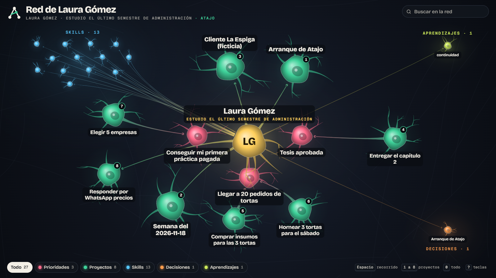
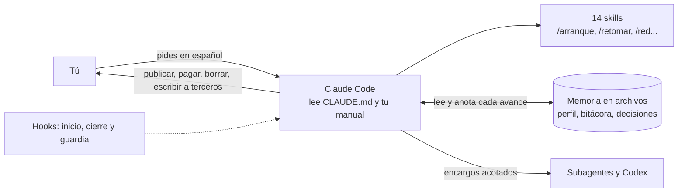

<picture><source media="(prefers-color-scheme: dark)" srcset="plantillas/red/identidad/atajo-logo.svg"></picture>

# Atajo

**Tu sistema operativo personal en español para Claude Code: recuerda quién eres, te enfoca en tus 3 prioridades y no hace nada delicado sin tu "sí".**

- **Para quién:** estudiantes, vendedores, profesionales y dueños de negocio pequeño. No necesitas saber programar.
- **Qué logras en 10 minutos:** respondes 4 preguntas y sale tu plan de la semana. Desde ahí, cada vez que abres Claude Code, sabe quién eres y en qué ibas.
- **Cuánto cuesta:** Atajo es gratis y de código abierto (MIT). Necesitas un plan pago de Claude, desde USD 20 al mes.



<sub>Tu sistema como una red de neuronas (`/red`), con datos de ejemplo. Es una página local, sin internet.</sub>

[English summary](README.en.md)

## Instálalo en 3 pasos

1. **Ten Claude Code** con un plan pago de Claude (Pro o superior). Si no lo tienes, mira [¿No tienes Claude Code?](#no-tienes-claude-code-o-un-plan-pago).
2. **Pega un comando:**

   Windows (abre PowerShell y pega):

   ```powershell
   irm https://raw.githubusercontent.com/davidricardobc/atajo/main/scripts/instalar.ps1 | iex
   ```

   Mac o Linux (abre la Terminal y pega):

   ```bash
   curl -fsSL https://raw.githubusercontent.com/davidricardobc/atajo/main/scripts/instalar.sh | bash
   ```

3. **Abre y arranca:**

   ```bash
   cd ~/atajo
   claude
   ```

   La primera vez, Claude Code pregunta si confías en la carpeta: di que sí. Luego escribe `/arranque`. Son 4 preguntas. Al terminar, `/red`.

¿Usas VS Code o la app de escritorio? Abre allí la carpeta `atajo` y escribe `/arranque`.

## Qué obtienes en 10 minutos

`/arranque` te hace 4 preguntas, una a la vez: quién eres, qué quieres lograr en 90 días, qué tienes esta semana y qué tarea repetitiva te come el tiempo. En unos 3 minutos te devuelve tu plan de la semana. Ejemplo real de salida, con datos ficticios:

```text
Tu semana, Camila · lunes 16 de noviembre

Prioridades (hasta el 15 de febrero)
1. Conseguir 3 clientes de diseño de marca · señal: 3 contratos firmados
2. Lanzar el portafolio nuevo · señal: publicado con 6 casos
3. Ordenar las finanzas del estudio · señal: flujo de caja al día cada viernes

Esta semana, en orden
1. Escribir a los 5 contactos que pidieron cotización en octubre · sirve a: P1 · lunes
2. Terminar el caso de la panadería para el portafolio · sirve a: P2 · martes
3. Mandar la propuesta a la tienda de ropa · sirve a: P1 · miércoles
4. Pasar las facturas de octubre a la hoja de cálculo · sirve a: P3 · viernes

No entra esta semana (Parqueadero)
- Rediseñar el logo propio

Para automatizar
- Armar cotizaciones a mano cada vez: en /leveling la convertimos en tu primera mejora.

Tu siguiente paso: copia uno de estos pedidos y pégalo aquí.
- "Empecemos con la tarea 1 de mi semana: dime por dónde arranco."
- "Escríbeme en borrador el mensaje para los 5 contactos que pidieron cotización."
- "Subamos de nivel: ¿qué hago a mano que podamos automatizar?"
```

Escribe `/red` y lo ves como en la imagen de arriba: tú al centro, tus 3 prioridades alrededor y tus tareas, decisiones y skills conectadas.

Pregúntale "¿en qué me enfoco esta semana?" y responde con tu lista, no con un discurso. Si quieres, sigues con la parte 2 de `/arranque` (tu voz, tus canales y cuánta autonomía le das), ahora o otro día. Para los primeros días hay una guía corta: [tu primera semana con Atajo](docs/primera-semana.md).

## Primeros 5 usos

Pega estos pedidos dentro de Claude Code, en la carpeta de Atajo, después de `/arranque`. Cámbiales los datos por los tuyos.

1. **Estudiante, semana de parciales:** "Tengo parciales de tres materias en las próximas dos semanas y trabajo medio tiempo. Arma mi plan de estudio por días, dime qué va primero y qué se queda en el Parqueadero."
2. **Estudiante o recién graduado, buscando empleo:** "Entrevístame sobre mis tres mejores proyectos y déjame escritos tres logros con números reales, sin inventar nada, para mi hoja de vida."
3. **Vendedor, cierre de semana:** "Estos son los cinco clientes con los que quedé pendiente: [pega la lista]. Dime a quién escribir primero, redáctame cada mensaje en borrador y no mandes nada hasta que yo diga sí."
4. **Dueño de negocio, cotizaciones:** "Cada vez armo las cotizaciones a mano. Entrevístame con las preguntas que hagan falta y déjame una plantilla de cotización reutilizable, con mis precios y mis condiciones."
5. **Dueño de negocio, una decisión difícil:** "Un cliente me pide 20 % de descuento y no estoy seguro. Hazme las preguntas que hagan falta, ayúdame a decidir y anota la decisión y el porqué en mi registro de decisiones."

Al cerrar la semana, para cualquiera: "Subamos de nivel: ¿qué estoy haciendo a mano que podamos automatizar?".

Para poner a trabajar a varios agentes a la vez (`/equipo`): "Mañana me reúno con una panadería. Arma el equipo y prepárame la reunión."

## Las skills

Una skill es un procedimiento que Claude sigue paso a paso. Se activan solas cuando pides algo parecido, o escribiendo su nombre con `/`. Para empezar te bastan cuatro, y `/equipo` cuando un encargo tiene partes que se pueden hacer a la vez:

| Skill | Para qué sirve |
|---|---|
| `/arranque` | 4 preguntas y sale tu plan de la semana. La parte 2, opcional, afina voz, canales y autonomía. |
| `/retomar` | Te dice en qué ibas y cuál es el siguiente paso, en una pestaña nueva o después de perder el contexto. |
| `/red` | Dibuja tu sistema como una red de neuronas: tú, tus prioridades, proyectos, decisiones y skills, en una página local. |
| `/leveling` | Revisión semanal: escoge una sola mejora, la construye, la prueba y sube un nivel. |
| `/equipo` | Arma un equipo de agentes (investigador, constructor, redactor y revisor) que trabajan a la vez; tú apruebas lo que sale. |

<details>
<summary><strong>Las otras 9 skills, para cuando las necesites</strong></summary>

| Skill | Para qué sirve |
|---|---|
| `/entrevista` | Saca lo que tienes en la cabeza sobre un plan, una decisión o un cliente, y lo deja escrito. |
| `/auditoria` | Revisa con evidencia que el sistema recuerde, enfoque, alcance y proteja. Semáforo por comprobación. |
| `/conectar` | Le enseña a Atajo un proyecto, carpeta, archivo o herramienta nueva por la ruta correcta. |
| `/diagnostico` | Convierte una conversación con un cliente en un diagnóstico honesto: si vale la pena, qué decide y qué falta. |
| `/propuesta` | Arma una propuesta en borrador con tres opciones, instalación y mensualidad, e hitos con aceptación. |
| `/aprender` | Investiga en fuentes confiables, anota lo aprendido con su fuente y propone una mejora al sistema. |
| `/seguridad` | Revisa tu sistema o la solución de un cliente, con lista de verificación de la Ley 1581 (Habeas Data). |
| `/publicar` | La puerta única antes de que algo salga: pruebas, impacto, cómo revertir y tu "sí" explícito. |
| `/codex` | Delega encargos acotados a Codex, si lo tienes instalado, y revisa lo que entrega. |

</details>

## Cómo funciona



- **Un agente que coordina.** Claude Code lee `CLAUDE.md` (reglas del kit) y `perfil/manual.md` (tus reglas) al abrir.
- **Skills.** Cada skill es un procedimiento en texto plano: entrevista, propuesta, revisión semanal, seguridad.
- **Memoria en archivos.** Tu perfil, tus prioridades y tu punto de retorno viven en archivos Markdown que puedes leer y corregir. Nada de bases de datos ni nubes.
- **Tú apruebas.** Publicar, pagar, borrar o escribir a alguien siempre pasa por tu "sí". Una guardia automática frena los comandos típicos de publicar o leer secretos.

Detalle técnico y decisiones de diseño en [docs/arquitectura.md](docs/arquitectura.md).

## Requisitos

- **Claude Code** con un plan Pro, Max, Ultra, Team o Enterprise de Claude. El plan gratis no incluye Claude Code ([fuente](https://code.claude.com/docs/en/setup)).
- **git**: recomendado, no obligatorio. Sin git, el instalador baja el zip.
- **Node.js**: opcional. Activa lo automático (cargar tu punto de retorno al abrir, recordarte cerrar el día, la guardia y el índice de notas). Sin Node todo funciona en modo manual con `/retomar`.
- **Codex**: opcional, solo para `/codex`.
- Windows 10 o 11, macOS 13 o superior, o Linux.

El instalador no pide permisos de administrador y no instala nada fuera de la carpeta de Atajo.

## ¿No tienes Claude Code o un plan pago?

- **Tienes plan pago pero no la terminal:** instala la [app de escritorio](https://code.claude.com/docs/en/desktop-quickstart) o la extensión de VS Code, abre la carpeta de Atajo y escribe `/arranque`. Para bajar la carpeta sin terminal, usa el zip (abajo).
- **Quieres instalar Claude Code en la terminal:** Windows `irm https://claude.ai/install.ps1 | iex`; Mac o Linux `curl -fsSL https://claude.ai/install.sh | bash` ([guía oficial](https://code.claude.com/docs/en/setup)).
- **Usas Codex:** Atajo trae `AGENTS.md` y una copia de las skills en `.agents/skills/`. Funciona sin hooks: la continuidad va por `/retomar`.
- **No tienes ninguno:** las guías de `guias/` (precios, diagnóstico de clientes, Ley 1581, orquestación) sirven solas como lectura.

## Instalar sin comandos (zip)

En la página del repositorio: botón **Code**, luego **Download ZIP**. Descomprímelo, abre la carpeta con Claude Code y escribe `/arranque`. Si tienes Node, tus archivos de datos se crean solos al abrir; si no, `/arranque` los crea.

## Actualizar y desinstalar

- **Actualizar:** corre otra vez el comando de instalación y responde "s". Con git hace `git pull`; sin git baja el zip y copia encima solo los archivos del kit. Tus datos no se tocan. Después escribe `/retomar`.
- **Desinstalar:** respalda tus datos (abajo) y borra la carpeta `atajo`. Eso es todo: Atajo no instala nada fuera de su carpeta. Si agregaste los plugins, quítalos con `/plugin` dentro de Claude Code.

## Tus datos y tu privacidad

Atajo separa dos cosas:

- **El kit**: skills, scripts, guías y plantillas. Está en git y se actualiza con `git pull`. No lo edites: tus cambios chocarían con la actualización. Lo que tú crees (skills, scripts o plantillas propias) va en archivos nuevos que empiezan por `mi-`, y la actualización nunca los toca.
- **Tus datos**: `perfil/`, `bitacora/`, `decisiones/`, `entrevistas/`, `revisiones/`, `conocimiento/`, `proyectos/`, `clientes/`, `archivo/`, `conexiones.md` y `kit.local.json`. Se crean desde `plantillas/datos/` y son solo tuyos. Git los ignora, así que una actualización nunca los pisa.

Tus reglas personales viven en `perfil/manual.md`. `CLAUDE.md` lo carga al arrancar y Codex lo lee al empezar.

Privacidad:

- Todo vive en archivos de texto en tu computador. Lo único que viaja es lo que Claude lee para responderte, igual que en cualquier sesión de Claude Code.
- Ninguna skill sube tus datos a ningún lado por su cuenta.
- Claude puede editar sin preguntarte solo tus carpetas de datos. El kit, `clientes/` y todo lo de afuera pasan por tu aprobación.
- El respaldo es tuyo: copia la carpeta a un disco o a tu nube, o guarda las carpetas de datos en un repositorio privado tuyo (revisa con `/seguridad` antes: `clientes/` lleva datos de otras empresas).

## ¿Solo quieres algunas skills?

Atajo también es un marketplace de plugins de Claude Code:

```text
/plugin marketplace add davidricardobc/atajo
/plugin install nucleo@atajo
```

| Plugin | Skills |
|---|---|
| `nucleo` | arranque, retomar, entrevista, leveling, auditoria, conectar, red |
| `ventas` | diagnostico, propuesta, aprender |
| `guardia` | seguridad, publicar |
| `taller` | codex, equipo (con sus cuatro agentes) |

Ojo: las skills trabajan sobre los archivos del kit (`kit.json`, `perfil/`, `bitacora/`, `plantillas/`, `scripts/`). Si las usas en una carpeta sin el kit, la skill lo detecta, te avisa y te ofrece instalarlo. La experiencia completa (memoria, hooks, guardia) viene con el kit instalado.

## Preguntas frecuentes

**¿Cuánto cuesta?** Atajo es gratis (MIT). Lo que pagas es tu plan de Claude: desde USD 20 al mes con Pro. El plan gratis de Claude no incluye Claude Code.

**¿Qué hace y qué no hace?** Hace: guarda quién eres y tus prioridades, te ordena la semana, frena las ideas que no sirven a ninguna prioridad, prepara borradores, diagnósticos y propuestas, y se acuerda de en qué ibas. No hace: publicar, pagar, borrar ni escribirle a nadie sin tu "sí". No reemplaza a un abogado, a un contador ni tu criterio.

**¿En qué se diferencia de otros kits?** Atajo arranca con 4 preguntas en unos 3 minutos y te entrega tu plan de la semana antes de configurar nada más. Está en español y pensado para quien no programa.

**¿Mis datos salen de mi computador?** Tus archivos se quedan en tu computador. Claude lee lo necesario para responderte, como en cualquier sesión de Claude Code. Atajo no tiene servidor ni base de datos, y nada de tus datos entra al repositorio.

**¿Gasta muchos tokens?** Gasta lo normal de Claude Code. Cada skill es un archivo corto que solo se lee completo cuando se usa, y la memoria se carga en pocas líneas al abrir. Si tu plan se queda corto, usa `/retomar` en una conversación nueva en vez de seguir en una muy larga.

**¿Necesito saber programar?** No. Hablas con Claude en español y él escribe los archivos. Si algo falla, pídele "ayúdame a arreglar Atajo".

**¿Sirve si no tengo negocio ni clientes?** Sí. Tus prioridades pueden ser de estudio, de trabajo o personales. Lo de clientes no aparece.

**¿Qué pasa si se acaba el contexto o cierro la terminal?** Nada se pierde. Cada avance se anota en `bitacora/ahora.md` al momento. Abres de nuevo y escribes `/retomar` (o se carga solo si tienes Node).

**¿Por qué me pide permiso la primera vez?** Claude Code pregunta si confías en la carpeta. Di que sí: así se activan los permisos y los hooks del kit.

**¿Puedo cambiar lo que hace?** Sí. Tus reglas van en `perfil/manual.md` (sección "Reglas propias"). Para cambiar una skill, cópiala en `.claude/skills/` con un nombre que empiece por `mi-` (por ejemplo `mi-propuesta`) o propón el cambio (ver `CONTRIBUIR.md`).

**¿Qué significan commit, remoto, subagente y esas palabras?** Claude te las explica la primera vez. *Commit*: foto guardada de tus archivos en git. *Remoto*: la copia del repositorio en internet. *Push*: subir esa foto (siempre te pide sí). *Subagente*: otra sesión de Claude que hace un encargo acotado. *Hook*: acción automática al abrir, al cerrar o antes de usar una herramienta.

**¿La revisión de la Ley 1581 es asesoría legal?** No. Es una lista de verificación con fuentes. Confirma con un abogado antes de firmar.

**¿La guardia me protege de todo?** No. Es una red de seguridad: frena los comandos típicos de publicar, borrar y leer secretos. Un comando escrito de otra forma puede pasar. La regla de fondo es que nada sale sin tu sí. Detalle en [docs/arquitectura.md](docs/arquitectura.md).

**¿Quiero contribuir?** Lee `CONTRIBUIR.md`. Los cambios se anotan en [CHANGELOG.md](CHANGELOG.md).

---

Hecho con Atajo · github.com/davidricardobc/atajo · © 2026 David Bajonero · Licencia [MIT](LICENSE).

Inspirado en la comunidad de código abierto (Addy Osmani, Nate Herk, Jesse Vincent y otros). Detalle en [CREDITOS.md](CREDITOS.md).
